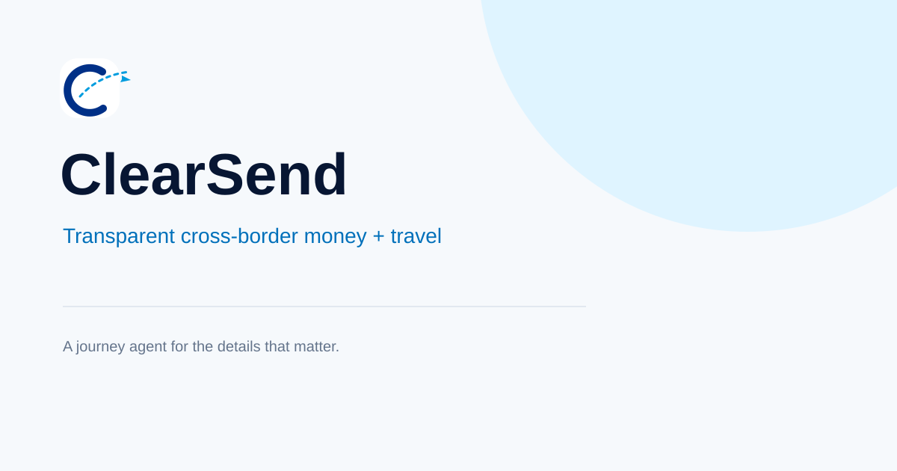

# ClearSend



**Cross-border remittance and travel planning with transparent fees, powered by PayPal + AI.**

ClearSend is an AI agent for worldwide journeys: send money across borders with clear FX rates and fees, search flights, and plan complete trips in one calm conversation. Built with PayPal sandbox APIs, NVIDIA NIM / OpenRouter, AI SDK, and the PayPal Agent Toolkit. Every money-moving action requires explicit human approval.

**Live demo:** https://clearsend-sigma.vercel.app/  
**Architecture:** Next.js 15 App Router → AI SDK streaming agent → PayPal Payouts + Orders + Agent Toolkit → Duffel/RapidAPI flights → approval-gated sandbox execution

---

## Judge quick start

### Golden prompts (working with UI chips)

Try these in the live demo or after local setup:

1. **"Send $500 to Lagos, Nigeria with transparent fees"**  
   Agent calculates remittance breakdown (fee, FX rate, amount received), then asks for recipient email for PayPal sandbox payout approval.

2. **"Search flights from New York to Lagos"**  
   Agent searches real flight offers via Duffel/RapidAPI and presents airline, price, duration, stops.

3. **"Plan a journey: remittance + flight in one conversation"**  
   Agent handles both tools, shows combined total, and requests separate approval for payout and flight order.

### Required environment variables

| Variable | Purpose | How to get |
| --- | --- | --- |
| `PAYPAL_CLIENT_ID` | PayPal sandbox app client ID | [developer.paypal.com/dashboard](https://developer.paypal.com/dashboard/) → Apps & Credentials → Sandbox → Create App |
| `PAYPAL_CLIENT_SECRET` | PayPal sandbox app secret | Same dashboard |
| `CLEAR_SEND_API_KEY` | Server-side auth for `/api/payouts` and `/api/orders` routes | Generate any strong random string (e.g. `openssl rand -hex 32`). **Do not commit this.** Only used when calling money routes directly (agent tools handle auth internally). |
| `NVIDIA_API_KEY` **or** `OPENROUTER_API_KEY` | AI provider for the agent | NVIDIA: [build.nvidia.com](https://build.nvidia.com/) (free tier). OpenRouter: [openrouter.ai](https://openrouter.ai/) (free models available). Agent uses NVIDIA if set, falls back to OpenRouter. |

**Optional:** `DUFFEL_API_KEY`, `RAPIDAPI_KEY`, `AVIATIONSTACK_API_KEY` for flight search. Agent gracefully degrades if flight providers are unavailable.

### Sandbox receiver email for payout demos

Use a **sandbox Personal account email** from [developer.paypal.com/dashboard → Sandbox → Accounts](https://developer.paypal.com/dashboard/accounts). Fake emails like `test@example.com` will return `DENIED` / `FAILED` status.

Example: `sb-yoursandbox47@personal.example.com` (replace with your actual sandbox account).

### How to verify locally

```bash
npm install
cp .env.example .env.local
# Add your PayPal sandbox credentials, NVIDIA or OpenRouter key, and CLEAR_SEND_API_KEY
npm run dev
```

Open http://localhost:3000 and try a golden prompt. The agent should:
- Stream responses (no generic "An error occurred")
- Show remittance cards with fee/FX breakdown
- Show flight cards with real offers (if flight keys configured)
- Display approval bar before any PayPal action
- Return payout batch ID or order ID after approval

### How to verify on Vercel after merge

1. Deploy to Vercel and add the same env vars under **Project Settings → Environment Variables** (Production + Preview).
2. Redeploy or trigger a new deployment.
3. Visit the live URL and try a golden prompt.
4. Check **Vercel Dashboard → Functions → Logs** if the agent returns errors. Look for:
   - `No AI provider is configured` → missing `NVIDIA_API_KEY` / `OPENROUTER_API_KEY`
   - `PayPal sandbox credentials are not configured` → missing `PAYPAL_CLIENT_ID` / `PAYPAL_CLIENT_SECRET`
   - `422` on order capture → order was not approved by user in PayPal sandbox (expected flow: create → user approves → capture)

---

## Local development

```bash
npm install
cp .env.example .env.local
npm run dev
```

Open http://localhost:3000. Flight search uses the configured worldwide provider chain. PayPal actions require sandbox credentials and an NVIDIA key for the agent.

## Environment variables

| Variable | Description | Required |
| --- | --- | --- |
| `PAYPAL_CLIENT_ID` | PayPal sandbox app client ID | **Yes** (for money) |
| `PAYPAL_CLIENT_SECRET` | PayPal sandbox app secret | **Yes** (for money) |
| `CLEAR_SEND_API_KEY` | Server-side auth token for `/api/payouts` and `/api/orders` direct calls. Generate a strong random string. Not needed for agent tool execution (agent handles auth internally). If not set, money routes log a warning but remain unprotected. | **Recommended** |
| `NVIDIA_API_KEY` | NVIDIA NIM API key | **Yes** (or use OpenRouter) |
| `NVIDIA_BASE_URL` | Optional base URL; defaults to `https://integrate.api.nvidia.com/v1` | No |
| `NVIDIA_MODEL` | Optional model; defaults to `meta/llama-3.1-405b-instruct` | No |
| `OPENROUTER_API_KEY` | Optional fallback key from [openrouter.ai](https://openrouter.ai/) | **Yes** (if no NVIDIA) |
| `OPENROUTER_BASE_URL` | Optional base URL; defaults to `https://openrouter.ai/api/v1` | No |
| `OPENROUTER_MODEL` | Optional fallback model; defaults to `meta-llama/llama-3.1-8b-instruct:free` | No |
| `DUFFEL_API_KEY` | Duffel test-mode token; primary flight provider | No |
| `RAPIDAPI_KEY` | RapidAPI key for Sky Scrapper backup flight search | No |
| `AVIATIONSTACK_API_KEY` | Aviationstack free-tier key for route/schedule backup | No |
| `KERNEL_API_KEY` | Optional Kernel browser key for the last-resort browser search | No |
| `KERNEL_API_URL` | Optional Kernel browser endpoint; defaults to `https://api.onkernel.com/v1/browser/sessions` | No |
| `ENABLE_KERNEL_FALLBACK` | Set to `true` to opt into browser fallback after all APIs fail | No |
| `NEXT_PUBLIC_APP_URL` | Public app URL for return/cancel URLs | No |
| `UPSTASH_REDIS_REST_URL` | Upstash Redis REST URL for escrow storage | **Yes** (for escrow) |
| `UPSTASH_REDIS_REST_TOKEN` | Upstash Redis REST token | **Yes** (for escrow) |

## PayPal Escrow

ClearSend includes a complete PayPal sandbox escrow system for secure payments with deliverable verification. Use it for freelance jobs, service agreements, or any transaction requiring proof of delivery before release.

### Escrow Flow

1. **Create Escrow**: Agent or user creates an escrow with payer, recipient (email or PayPal payer ID, country, currency), amount, and a written specification with acceptance criteria.
2. **Fund Escrow**: Funds are deposited into the platform's PayPal account via PayPal Orders v2 (create → payer approval → capture). Escrow state becomes 'funded' only after capture is COMPLETED.
3. **Submit Deliverable**: Recipient submits deliverable (text/URL/notes) for evaluation.
4. **Verify Deliverable**: Agent evaluates the deliverable against the specification using an LLM with structured output (met: boolean, reasons, per-criterion results). No auto-release without a passing evaluation.
5. **Approve Release**: Human approval step (ApprovalBar) before any payout is sent.
6. **Release Funds**: On approved release, funds are sent via PayPal Payouts API to the recipient's PayPal email/phone/payer ID in any supported country/currency. Payout batch ID and status are recorded.
7. **Refund Path**: If spec is not met or user cancels, the captured payment is refunded via `/v2/payments/captures/{id}/refund`.

### Escrow State Machine

`created` → `funded` → `submitted` → `verified|rejected` → `released|refunded`

State transitions are idempotent and never double-pay.

### Escrow Storage

Escrow records are persisted server-side in Upstash Redis (via env `UPSTASH_REDIS_REST_URL` and `UPSTASH_REDIS_REST_TOKEN`). If not configured, falls back to in-memory storage with a warning (data lost on restart).

**Recommended**: Use Upstash Redis REST for production. Create a free database at [console.upstash.com](https://console.upstash.com/), copy the REST URL and token, and add them to your environment variables.

### Escrow API Routes

- `POST /api/escrow/create` - Create a new escrow
- `POST /api/escrow/fund` - Fund an escrow (create order or capture existing order)
- `POST /api/escrow/submit` - Submit deliverable for verification
- `POST /api/escrow/verify` - Evaluate deliverable with LLM
- `POST /api/escrow/release` - Release funds to recipient (requires human approval)
- `POST /api/escrow/refund` - Refund captured payment to payer
- `GET /api/escrow/[id]` - Get escrow details by ID

### Escrow Agent Tools

- `createEscrow` - Create a new escrow
- `getEscrow` - Get escrow details by ID
- `listEscrows` - List all escrows (newest first)

### Escrow UI Component

`EscrowCard` displays escrow state, timeline, amounts, specification, deliverable (if submitted), and evaluation results.

### Testing Escrow in Sandbox

1. Create an escrow with specification and acceptance criteria
2. Use the returned escrow ID to fund it (creates PayPal order)
3. Approve the order in PayPal sandbox
4. Capture the order to move escrow to 'funded' state
5. Submit a deliverable for verification
6. Verify the deliverable (LLM evaluates against criteria)
7. If verified, approve release (human approval step)
8. Funds are sent via PayPal Payouts to recipient

**Note**: All PayPal operations use sandbox mode. Never send real money outside the PayPal sandbox unless env is explicitly live.

## Get credentials

### PayPal sandbox (required for money actions)

1. Sign in at [developer.paypal.com](https://developer.paypal.com/dashboard/).
2. Open **Apps & Credentials**, switch to **Sandbox**, and create an app.
3. Copy the app's Client ID and Secret into `PAYPAL_CLIENT_ID` and `PAYPAL_CLIENT_SECRET`.
4. Create a sandbox **Personal account** under **Sandbox → Accounts** for the recipient email used during payout approval. Use the email from this account in your demo (e.g. `sb-yoursandbox47@personal.example.com`). **Fake emails will fail.**
5. Every PayPal request is hard-coded to `api-m.sandbox.paypal.com`.

### NVIDIA NIM (recommended AI provider)

1. Create a free account at [build.nvidia.com](https://build.nvidia.com/).
2. Create an API key from the account menu.
3. Set it as `NVIDIA_API_KEY`. The agent uses model `meta/llama-3.1-405b-instruct` by default (free tier).

### OpenRouter fallback (alternative AI provider)

1. Create an account at [openrouter.ai](https://openrouter.ai/).
2. Create an API key and set it as `OPENROUTER_API_KEY`.
3. The agent uses `meta-llama/llama-3.1-8b-instruct:free` by default. ClearSend uses NVIDIA when `NVIDIA_API_KEY` is set and automatically selects OpenRouter when it is unavailable.

## Worldwide flight providers

ClearSend tries providers in this order and returns the first non-empty result:

1. Duffel test mode via `DUFFEL_API_KEY`.
2. RapidAPI Sky Scrapper via `RAPIDAPI_KEY`.
3. Aviationstack via `AVIATIONSTACK_API_KEY`.
4. Optional Kernel browser fallback, only when `ENABLE_KERNEL_FALLBACK=true` and `KERNEL_API_KEY` is configured.

The agent accepts IATA codes or city names and returns airline, price, times, stops, and duration. Provider errors are logged and the next provider is tried. If all providers fail, ClearSend returns a clear error instead of inventing an offer.

### Free provider keys

- **Duffel:** create a test account at [duffel.com](https://duffel.com), then copy a `duffel_test_` token from the dashboard.
- **RapidAPI:** create a free account at [rapidapi.com](https://rapidapi.com), subscribe to the Sky Scrapper / Air Scraper BASIC plan, and copy `RAPIDAPI_KEY`.
- **Aviationstack:** create a free account at [aviationstack.com](https://aviationstack.com) and copy the access key.
- **Kernel:** create an account at [onkernel.com](https://onkernel.com), copy the API key, and explicitly enable the fallback flag. Browser search is never the default.

For a complete conversation, ask ClearSend to calculate a transfer and find a flight in one request. It will show both results, a combined total, and separate approval controls before any PayPal action.

## Deploy to Vercel

Import this repository into Vercel, add the variables above under **Project Settings → Environment Variables** for Preview and Production, and deploy. The App Router API routes are deployed as serverless functions. Set `NEXT_PUBLIC_APP_URL` to the final Vercel URL.

**Required for working demo:**
- `PAYPAL_CLIENT_ID` + `PAYPAL_CLIENT_SECRET` (sandbox)
- `NVIDIA_API_KEY` or `OPENROUTER_API_KEY`
- `CLEAR_SEND_API_KEY` (recommended for money route protection)

**Optional for flight search:**
- `DUFFEL_API_KEY`, `RAPIDAPI_KEY`, or `AVIATIONSTACK_API_KEY`

Keep the PayPal credentials in sandbox mode; this app rejects non-sandbox PayPal URLs.

For CLI deployment, run `npx vercel`, then add variables with `vercel env add`.

## GitHub

Create the public repository and push the project with GitHub CLI:

```bash
gh auth login
gh repo create clearsend-journey --public --source=. --remote=origin --push
```

Or create an empty public repository named `clearsend-journey` in GitHub, then run:

```bash
git remote add origin https://github.com/YOUR_USERNAME/clearsend-journey.git
git add .
git commit -m "Build ClearSend Journey Agent"
git branch -M main
git push -u origin main
```

## API safety

**Agent tool execution:** The agent's `createPayout` and `createOrder` tools require explicit user approval before execution. The UI displays an approval bar; nothing moves until the user clicks "Approve action."

**Direct API routes:** `/api/payouts` and `/api/orders` are protected by `CLEAR_SEND_API_KEY`. If the env var is set, direct calls require a matching `x-clearsend-api-key` header (returns `401` otherwise). If `CLEAR_SEND_API_KEY` is not set, a warning is logged and the routes remain unprotected for demo purposes. **Agent tool execution does not call these routes directly**—tools use the PayPal SDK internally with server-side credentials.

**Orders flow:** `createOrder` creates a PayPal order and returns an `approveUrl`. The user must open this URL in PayPal sandbox and approve the payment. After approval, call `captureOrder` to finalize. Auto-capture without user approval fails with `422`.

**Credentials:** All PayPal and AI provider secrets stay server-side. Never expose them through `NEXT_PUBLIC_` variables.
